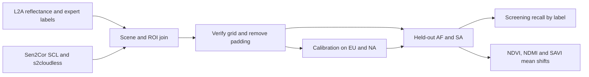
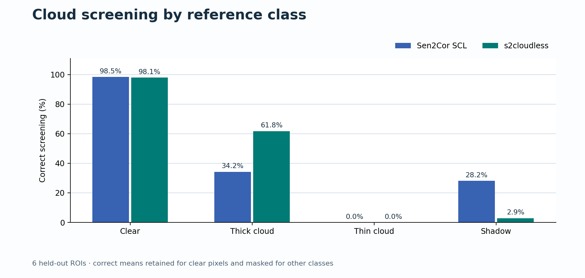
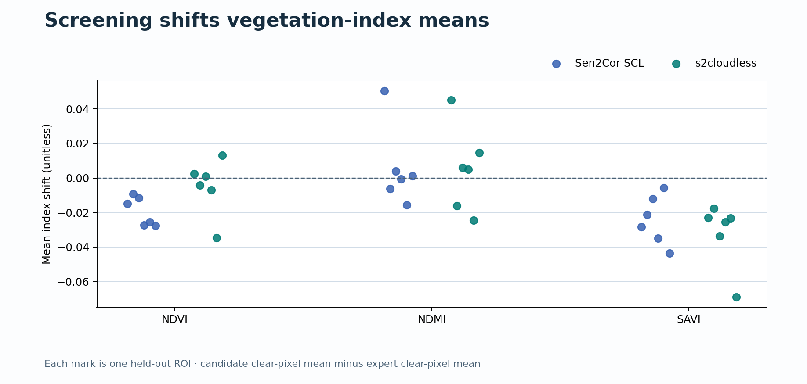
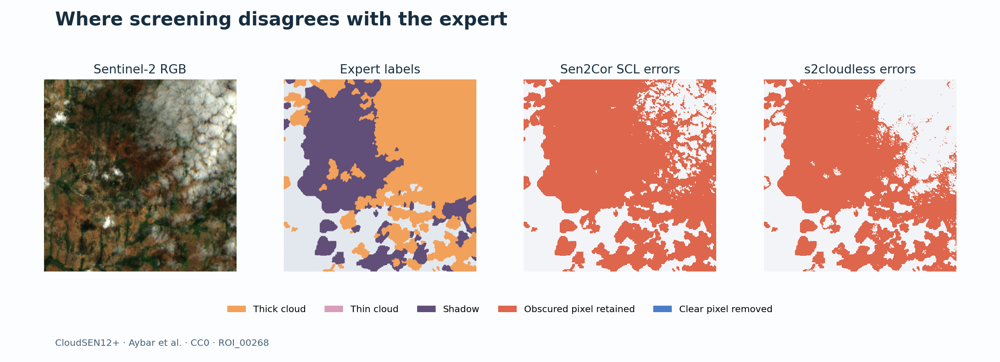

# Sentinel Cloud Mask Transfer Audit

Compare Sen2Cor Scene Classification and a calibrated s2cloudless threshold against expert CloudSEN12+ masks. The audit measures how pixels retained by each method change the mean NDVI, NDMI and SAVI.

## Data and controls

The [CloudSEN12+ catalog](https://huggingface.co/datasets/tacofoundation/cloudsen12) provides surface reflectance and expert labels in its L2A collection and both cloud products in its auxiliary collection. The acquisition joins the collections by scene ID and checks the original Sentinel scene, ROI, CRS and affine transform. It then records byte lengths and SHA-256 hashes for each GeoTIFF. See Aybar et al., [CloudSEN12+](https://doi.org/10.1016/j.dib.2024.110852), and the source [CC0 declaration](https://huggingface.co/datasets/isp-uv-es/CloudSEN12Plus).

Four scenes from the European and North American validation regions calibrate the probability threshold. Six separate scenes from Africa and South America are held out for evaluation. The sampling deliberately includes expert-labeled thick cloud and shadow. The ten regions of interest are disjoint by source ID.

## Method



The optical cube stores integer reflectance with a scale factor of 0.0001. The window uses the real 509 × 509 pixels and verifies the zero-valued right and bottom padding in the downloaded data. The audit checks the raster windows' transforms and excludes nodata, invalid SCL classes and all-zero reflectance. Sen2Cor classes 3, 8, 9 and 10 mark cloud shadow or cloud. s2cloudless thresholds range from 0.20 to 0.80, using binary balanced accuracy on the calibration regions.

For each scene and index, the reported shift is the mean over pixels retained by a method minus the mean over expert-clear pixels. NDMI uses B08 and B11. SAVI uses a soil adjustment factor of 0.5. The comparison measures changes in the retained sample, with one observation per valid index pixel.

## Results

The calibrated s2cloudless threshold is **0.40**. Both methods evaluate the same 1,554,486 valid pixels.

| Method | Binary balanced accuracy | Thick cloud masked | Shadow masked |
| --- | ---: | ---: | ---: |
| Sen2Cor SCL | 64.97% | 34.24% | 28.17% |
| s2cloudless ≥ 0.40 | 66.47% | 61.80% | 2.90% |

Neither method masked the 224 thin-cloud reference pixels in this sample. The median per-ROI NDVI shift was −0.0202 for SCL and −0.0016 for s2cloudless. The scene-wise variation, uneven class support and small set of regions limit extrapolation. [Metrics](reports/cloud-audit.json) · [Acquisition manifest](reports/source-manifest.json)







## Reproduce

```powershell
python -m pip install -r requirements.txt
python fetch_cloudsen12.py
python -m unittest discover -s tests -v
python audit.py --out runs/benchmark
python plot_results.py --metrics runs/benchmark/metrics.json --example runs/benchmark/example.npz
```

The GitHub workflow checks the grid-independent screening and index calculations. The integration run validates the 40 source rasters locally. The repository includes aggregate scores and plots.
